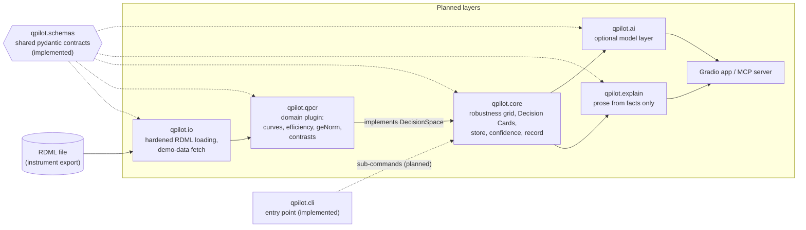

# qPilot

**Open qPCR analysis that reads the instrument's raw curves, analyses every plate the same way, and shows which of your analysis choices could change your conclusion.**


> [!IMPORTANT]
> **For research use only. Not for clinical or diagnostic use.**

> [!NOTE]
> **Project status: early scaffold (v0.1.0).** This repository contains the package skeleton,
> the data contracts every layer is built against, a command-line shell with an `info`
> diagnostics command, contract fixtures for the demo study and the quality tooling. The analysis
> engine, web app, MCP server and AI layer described under [Roadmap](#roadmap) are **not
> implemented yet**. Everything in this README that is not marked *planned* works today.

## Contents

- [Overview](#overview)
- [What works today](#what-works-today)
- [Tech stack](#tech-stack)
- [Architecture](#architecture)
- [Project structure](#project-structure)
- [Prerequisites](#prerequisites)
- [Installation](#installation)
- [Configuration](#configuration)
- [Usage](#usage)
- [Python API reference](#python-api-reference)
- [Scripts and commands](#scripts-and-commands)
- [Testing](#testing)
- [Linting, formatting and type-checking](#linting-formatting-and-type-checking)
- [Building and deployment](#building-and-deployment)
- [Troubleshooting and FAQ](#troubleshooting-and-faq)
- [Known limitations](#known-limitations)
- [Roadmap](#roadmap)
- [Contributing](#contributing)
- [Security](#security)
- [Citing, licence and third-party notices](#citing-licence-and-third-party-notices)

## Overview

### The problem

A qPCR result such as *"ODC1 is 3.6-fold up in MYCN-high tumours"* depends on choices the
analyst makes along the way:

- which **reference genes** to normalise against,
- where to **cut the groups** (for example, the expression threshold that defines "MYCN-high"),
- what to do with **undetermined wells** (drop them, or cap them at a maximum Cq).

Each choice is usually made once, silently, and the published fold change hides the fact that a
different, equally defensible choice might have flipped the conclusion.

### What qPilot is for

qPilot's aim is to make those choices explicit, re-run the analysis under every reasonable
alternative, and tell you which conclusions survive and which flip. The output is designed
around three ideas, all of which already exist as data contracts in this repository:

1. **Robustness** — for every gene, the share of the analysis grid in which its conclusion
   (up / down / none) holds.
2. **Decision Cards** — each choice that could change a conclusion, ranked by how many genes it
   flips, with options, evidence and a recommended option.
3. **Confidence grades** — an ordinal level (High / Moderate / Low / Very low) with every
   downgrade named. Never a probability.

### Who it is for

- **Bench scientists and core facilities** who analyse qPCR data and want to know whether a
  result depends on an arbitrary analysis choice.
- **Reviewers and PIs** who want a tamper-evident record of how a result was reached (planned).
- **Developers** building the engine, app or integrations against the shared contracts — this is
  the main audience of the repository today.

## What works today

| Area | What you get | Where |
|---|---|---|
| Data contracts | pydantic v2 models for contrasts, geNorm stability, robustness, confidence grades, Decision Cards, the hash-chained decision log, design-planning results, plus the `DecisionSpace` and `StudyStoreAPI` protocols | `qpilot/schemas.py` |
| Contract fixtures | Expected results, three Decision Cards and 601 citable facts for the 64-plate Vermeulen neuroblastoma benchmark (24,576 reactions, 366 samples, 58 genes) | `tests/fixtures/` |
| RDML fixtures | A small real RDML file for smoke tests and an XXE regression file for the future hardened loader | `tests/fixtures/*.rdml` |
| CLI | `qpilot` / `python -m qpilot` with `--version`, a status-aware `--help`, and `qpilot info [--json]` for environment diagnostics | `qpilot/cli/` |
| Tests | 55 tests: schema validation, fixture self-consistency, CLI behaviour, package boundaries, RDML fixture sanity | `tests/` |
| Quality rails | ruff (lint + format), strict mypy with the pydantic plugin, pytest with network disabled, pre-commit (ruff, gitleaks), pip-audit, Dependabot, GitHub Actions CI | repo root, `.github/` |

## Tech stack

| Layer | Technology | Status |
|---|---|---|
| Language | Python 3.11, 3.12, 3.13 | in use |
| Data contracts | [pydantic](https://docs.pydantic.dev/) v2 | in use |
| CLI | `argparse` (standard library) | in use |
| Packaging | [hatchling](https://hatch.pypa.io/) via `pyproject.toml`, `python -m build` | in use |
| Numerics | numpy, scipy, pandas | declared, not imported yet |
| RDML parsing | lxml (hardened, no external entities) | declared, not imported yet |
| App and charts | gradio, plotly | declared, not imported yet |
| Agent integration | mcp (Model Context Protocol SDK) | declared, not imported yet |
| Config and locking | PyYAML, filelock | declared, not imported yet |
| Optional extras | `ai` (anthropic, httpx), `parquet` (pyarrow), `xlsx` (openpyxl) | declared, not imported yet |
| Tooling | ruff, mypy, pytest, pytest-socket, pre-commit, gitleaks, pip-audit, pip-licenses, cyclonedx-bom | in use |

The heavy runtime dependencies are declared up front so every module can be built against one
environment. Until the engine lands they make `pip install` slower than the code needs (see
[Known limitations](#known-limitations)).

## Architecture

The layers talk to each other only through the pydantic models in `qpilot.schemas`. The
robustness core is domain-agnostic: it reaches the qPCR code only through the `DecisionSpace`
protocol, and a test runs a fresh interpreter to prove that importing `qpilot.core` never imports
`qpilot.qpcr`.



Design rules the contracts encode:

- **Facts, not free numbers.** Every number prose may show is a `Fact` with an id, a value, a
  format string and the `path` of the result field it came from. Explanations (template- or
  model-written) may quote numbers only by fact id, so a sentence can never contain a number
  the engine did not produce.
- **Ordinal confidence.** `Grade.level` is one of four labels and every downgrade is a named
  `Check`; there is no probability field.
- **Tamper-evident decisions.** Each `DecisionEntry` carries `prev_hash` and its own `hash`
  (sha256 of the canonical JSON without `hash`), forming a chain. `append_decision` takes an
  `expected_head` and refuses with `stale` if someone else decided first.
- **Humans stay in charge.** Cards carry an autonomy level (`suggest`, `decide_and_tell`, …) and
  agent decisions can be parked as `pending_human`.

## Project structure

```
qpilot/
├── qpilot/
│   ├── __init__.py          package version (__version__)
│   ├── __main__.py          enables `python -m qpilot`
│   ├── schemas.py           shared pydantic data contracts and protocols  ← the stable API
│   ├── py.typed             marks the package as typed (PEP 561)
│   ├── cli/
│   │   ├── __init__.py      argparse dispatcher: build_parser(), main()
│   │   ├── _types.py        the Command tuple type
│   │   ├── meta_cmds.py     `qpilot info` diagnostics command
│   │   ├── engine_cmds.py   registry for analysis-engine/app commands (empty, planned)
│   │   └── core_cmds.py     registry for core/record/integration commands (empty, planned)
│   ├── io/                  RDML loading and dataset fetching (planned)
│   ├── qpcr/                qPCR domain plugin (planned)
│   ├── core/                robustness grid, decisions, store, confidence (planned)
│   ├── explain/             explanation templates rendered from facts (planned)
│   ├── ai/                  optional model layer (planned)
│   ├── harness/             model evaluation harness (planned)
│   └── vendor/              third-party code vendored at pinned commits (planned)
├── tests/
│   ├── conftest.py          shared fixtures; auto-skips `demo_data` tests without the dataset
│   ├── contracts/
│   │   ├── test_schemas.py  models accept valid data and reject invalid literals/shapes
│   │   └── test_fixtures.py fixtures are internally consistent (facts, rules, CIs, cards)
│   ├── fixtures/            results.json, cards.json, facts.json, small RDML files (+ README)
│   ├── test_cli.py          CLI help, version, registration, exit codes, `info`
│   ├── test_packages.py     sub-packages import; core never imports qpcr; `python -m qpilot`
│   └── test_rdml_fixtures.py  smoke RDML is a zipped RDML; XXE file is inert when parsed safely
├── .github/
│   ├── workflows/ci.yml     lint, type-check, tests (3.11–3.13), build, dependency audit
│   └── dependabot.yml       weekly dependency updates
├── pyproject.toml           metadata, dependencies, extras, entry point, mypy config
├── ruff.toml                lint and format rules (Google docstrings on public API)
├── pytest.ini               test paths, strict markers, network disabled
├── .pre-commit-config.yaml  ruff, whitespace fixers, large-file guard, gitleaks
├── CITATION.cff             how to cite qPilot and the methods it builds on
├── SECURITY.md              vulnerability reporting and security design rules
├── THIRD_PARTY_NOTICES.md   vendored code, dependency licences, data licences
├── CODEOWNERS
└── LICENSE                  Apache-2.0
```

## Prerequisites

| Requirement | Version | Notes |
|---|---|---|
| Python | 3.11 or newer | CI tests 3.11, 3.12 and 3.13. `python3 --version` to check. |
| pip | recent | `python -m pip install --upgrade pip` avoids resolver issues with the large dependency set. |
| git | any | to clone the repository |
| Disk / network | a few hundred MB | the declared dependencies (gradio, scipy, pandas, …) are large |

No database, external service, API key or GPU is needed.

## Installation

1. **Clone the repository.**

   ```bash
   git clone https://github.com/jeevithg090/qpilot.git
   cd qpilot
   ```

2. **Create and activate a virtual environment.**

   ```bash
   python -m venv .venv
   source .venv/bin/activate          # Windows: .venv\Scripts\activate
   python -m pip install --upgrade pip
   ```

3. **Install the package.** Pick one:

   ```bash
   pip install -e ".[dev]"            # contributors: package + test/lint/type/build tools
   pip install -e ".[dev,ai]"         # as CI runs the tests
   pip install .                      # users: just the package
   ```

   Optional extras can be combined: `ai`, `parquet`, `xlsx` (for example `pip install -e ".[dev,parquet,xlsx]"`).

4. **Check the install.**

   ```bash
   qpilot --version                   # qpilot 0.1.0
   qpilot info                        # interpreter, install location, extras
   pytest                             # 55 passed
   ```

5. *(Optional, contributors)* **Install the git hooks.**

   ```bash
   pre-commit install
   ```

## Configuration

qPilot has no configuration file and needs no secrets. These are the only environment-dependent
settings:

| Name | Kind | Required | Default | Description |
|---|---|---|---|---|
| `QPILOT_STUDIES_DIR` | environment variable | no | *(none)* | Reserved for the planned on-disk study store. **Not read by any code yet.** The `tmp_studies_dir` pytest fixture sets it to a temporary directory so future store tests never touch a real workspace. |
| `~/.cache/qpilot/data_vermeulen_raw.rdml` | file path | no | — | Location of the 64-plate demo dataset. Tests marked `demo_data` run only when this file exists, and `qpilot info` reports whether it is present. The planned fetch command will download it here with a SHA-256 pin; until then it must be placed by hand. |

Tool configuration lives in `pyproject.toml` (packaging, mypy), `ruff.toml`, `pytest.ini` and
`.pre-commit-config.yaml`.

## Usage

### Command line

The CLI is a dispatcher that each layer will add sub-commands to. Today it has one command,
`info`.

```console
$ qpilot --help
usage: qpilot [-h] [--version] <command> ...

qPilot: open qPCR analysis. Research use only; not for clinical or diagnostic use.

Status: early scaffold. The data contracts and this command line exist; the analysis
commands (load, analyse, report) are planned and not available yet.

options:
  -h, --help  show this help message and exit
  --version   show program's version number and exit

commands:
  <command>
    info      show version, Python, install location and optional extras
              (useful in bug reports)

examples:
  qpilot info            show version, Python and optional extras
  qpilot info --json     the same, as JSON for bug reports
  qpilot <command> -h    help for one command

docs: https://github.com/jeevithg090/qpilot#readme
```

`qpilot info` prints what is useful in a bug report. Example output (paths and platform vary by
machine):

```console
$ qpilot info
qpilot 0.1.0  (research use only; not for clinical or diagnostic use)

  python        3.13.18 (CPython)
  platform      Linux-6.18.44-x86_64-with-glibc2.39
  executable    /path/to/qpilot/.venv/bin/python3
  package       /path/to/qpilot/qpilot
  demo dataset  not cached: /home/you/.cache/qpilot/data_vermeulen_raw.rdml

  optional extras
    ai        installed
    parquet   not installed (missing pyarrow); pip install "qpilot[parquet]"
    xlsx      not installed (missing openpyxl); pip install "qpilot[xlsx]"
```

`qpilot info --json` prints the same data as JSON (keys: `version`, `python`, `implementation`,
`platform`, `executable`, `package_dir`, `demo_dataset.{path,cached}`,
`extras.<name>.{installed,missing}`).

Exit codes: `0` success (including `qpilot` with no command, which prints the help), `2` usage
error such as an unknown command, `130` interrupted with Ctrl-C. `python -m qpilot` behaves
exactly like `qpilot`.

```console
$ qpilot bogus
usage: qpilot [-h] [--version] <command> ...
qpilot: error: argument <command>: invalid choice: 'bogus' (choose from 'info')
```

### Working with the data contracts

The contracts are ordinary pydantic models, so the fixtures can be loaded and explored directly.
Run from the repository root:

```python
import json
from pathlib import Path

from qpilot.schemas import DecisionCard, StudyResult

result = StudyResult.model_validate_json(Path("tests/fixtures/results.json").read_text())
odc1 = result.contrasts["ODC1"]
print(
    f"{odc1.target}: {odc1.fc:.2f}-fold {odc1.conclusion} "
    f"(95% CI {odc1.ci[0]:.2f}-{odc1.ci[1]:.2f}, p={odc1.p:.1e})"
)
print(
    "holds in",
    f"{result.robustness['ODC1'].holds:.0%}",
    "of",
    result.robustness["ODC1"].n_cells,
    "grid cells",
)
print("confidence:", result.confidence["ODC1"].level)

cards = [
    DecisionCard.model_validate(c)
    for c in json.loads(Path("tests/fixtures/cards.json").read_text())
]
for card in cards:
    print(
        card.rank,
        card.kind,
        "flips",
        card.impact["n_genes_flipped"],
        "genes; recommended:",
        card.recommended,
    )
```

Output:

```text
ODC1: 3.59-fold up (95% CI 2.42-5.33, p=2.3e-08)
holds in 100% of 186 grid cells
confidence: Moderate
1 reference_set flips 31 genes; recommended: recommended
2 group_cutoff flips 17 genes; recommended: cut_15
3 undetermined flips 0 genes; recommended: drop
```

So in the demo study the choice of reference genes is the riskiest decision (it can flip 31 of
58 genes), while ODC1's up-regulation survives every combination in the grid.

Invalid data is rejected with a precise error:

```python
>>> from qpilot.schemas import ContrastResult
>>> ContrastResult(target="X", log2fc=1, fc=2, ci=(1, 3), p=0.01, t=3,
...                n_hi=5, n_lo=5, conclusion="maybe")
pydantic_core._pydantic_core.ValidationError: 1 validation error for ContrastResult
conclusion
  Input should be 'up', 'down' or 'none' [type=literal_error, input_value='maybe', input_type=str]
```

### Adding a CLI command

Commands are `(name, help, add_arguments, run)` tuples appended to the `COMMANDS` list of the
module that owns them (`meta_cmds.py`, `engine_cmds.py` or `core_cmds.py`). `run(args)` returns an
exit code; `None` means `0`. Duplicate names raise `ValueError` when the parser is built.

```python
# qpilot/cli/engine_cmds.py
import argparse

from qpilot.cli._types import Command


def _add_arguments(parser: argparse.ArgumentParser) -> None:
    parser.add_argument("path", help="RDML file to load")


def _run(args: argparse.Namespace) -> int:
    print(f"would load {args.path}")
    return 0


COMMANDS: list[Command] = [("load", "load an RDML file", _add_arguments, _run)]
```

`build_parser(commands=[...])` accepts an explicit list, which is how `tests/test_cli.py` tests
commands in isolation.

## Python API reference

There is no HTTP API. The public Python API is `qpilot.schemas` and `qpilot.cli`.

### Models (`qpilot.schemas`)

| Model | Purpose | Key fields |
|---|---|---|
| `ContrastResult` | One gene's comparison between the two groups under one set of choices | `target`, `log2fc`, `fc`, `ci`, `p`, `t`, `n_hi`, `n_lo`, `conclusion` (`up`/`down`/`none`) |
| `GenormResult` | Reference-gene stability ranking (geNorm M and V) | `M_initial`, `order`, `V`, `recommended`, `cutoff_M`=1.5, `cutoff_V`=0.15 |
| `DesignSummary` | How the comparison groups were defined | `group_var`, `cut`, `n_hi`, `n_lo`, `note`, `refs_primary` |
| `Check` | One named component of a confidence grade | `id`, `passed`, `note`, `fact_ids` |
| `Grade` | Ordinal confidence with every downgrade named | `level` (`High`/`Moderate`/`Low`/`Very low`), `reasons`, `checks`, `min_flip_changes` |
| `GeneRobustness` | How often a gene's conclusion holds across the grid | `target`, `conclusion`, `fc`, `holds` (0–1), `n_cells`, `impact` per dimension |
| `Fact` | A number or label prose may reference by id | `id`, `value`, `fmt`, `unit`, `path` |
| `CardOption` | One option on a Decision Card | `id`, `label`, `per_gene` |
| `DecisionCard` | A choice that could change a conclusion | `id`, `kind` (`reference_set`/`group_cutoff`/`undetermined`), `rank`, `impact`, `evidence`, `options`, `recommended`, `autonomy`, `status`, `decision`, … |
| `StudyResult` | Everything the engine computed for one study | `study_id`, `input_sha256`, counts, `design`, `genorm`, `contrasts`, `robustness`, `confidence`, `efficiency`, `conclusion_rule`, `facts` |
| `DecisionEntry` | One line of the hash-chained `decisions.jsonl` | `seq`, `prev_hash`, `card_id`, `option`, `reason`, `actor`, `status`, `at`, `hash` |
| `DecisionOutcome` | Result of trying to decide a card | `status` (`applied`/`stale`/`pending_human`/`rejected`), `chain_head`, `card`, `reason` |
| `PlanResult` | Design check before an experiment | `n_needed`, `mde_fold`, `cannot_detect`, `rules`, `message` |

Type aliases: `Conclusion`, `Actor` (`human`/`agent`/`system`), `Autonomy`, `Level`.

### Protocols (`qpilot.schemas`)

| Protocol | Implemented by | Members |
|---|---|---|
| `DecisionSpace` | the qPCR plugin (planned `qpcr/space.py`) | `dimensions`, `primary`, `items`, `evaluate(cell) -> dict[str, ContrastResult]`, `conclude(result) -> Conclusion` |
| `StudyStoreAPI` | the on-disk store (planned `core/store.py`) | `get`, `put`, `cards`, `chain_head`, `append_decision(..., expected_head)`, `pending` |

### CLI (`qpilot.cli`)

| Function | Description |
|---|---|
| `build_parser(commands=None)` | Build the `argparse` parser. Defaults to every registered command; raises `ValueError` on duplicate names. |
| `main(argv=None)` | Parse `argv`, run the selected command and return its exit code. |
| `Command` | Type alias for the `(name, help, add_arguments, run)` registration tuple. |

## Scripts and commands

| Task | Command |
|---|---|
| Show help | `qpilot --help` |
| Show version | `qpilot --version` |
| Environment diagnostics | `qpilot info` / `qpilot info --json` |
| Run all tests | `pytest` |
| Run tests as CI does | `pytest -q -m "not demo_data"` |
| Run one test file | `pytest tests/test_cli.py -v` |
| Lint | `ruff check .` (auto-fix: `ruff check --fix .`) |
| Format | `ruff format .` (check only: `ruff format --check .`) |
| Type-check | `mypy qpilot tests` |
| Build sdist and wheel | `python -m build` |
| Audit dependencies | `pip-audit` |
| Licence report | `pip-licenses` |
| SBOM | `cyclonedx-py environment -o sbom.json` |
| Install git hooks | `pre-commit install` |
| Run all hooks | `pre-commit run --all-files` |

## Testing

```bash
pytest                       # 55 tests, well under a second
pytest -q -m "not demo_data" # exactly what CI runs
```

What is covered:

| File | Covers |
|---|---|
| `tests/contracts/test_schemas.py` | Models accept valid data; reject unknown conclusions, kinds and actors and malformed CIs; mutable defaults are not shared; grades are ordinal labels, never probabilities. |
| `tests/contracts/test_fixtures.py` | The fixtures agree with each other: locked study counts; JSON round-trip; every gene has a contrast, robustness entry and grade; `fc == 2**log2fc` and the fold change lies inside its CI; every conclusion follows `conclusion_rule`; each card's recommended option reproduces the primary contrasts; every referenced fact id exists and every fact's value matches the field its `path` points to. |
| `tests/test_cli.py` | Help and version output, unknown-command usage error, duplicate-name rejection, argument passing, exit-code propagation, `info` text and JSON output, extras list matches `pyproject.toml`, Ctrl-C exits 130. |
| `tests/test_packages.py` | Version matches `pyproject.toml`; every sub-package imports and has a docstring; `qpilot.core` does not import `qpilot.qpcr` (fresh interpreter); `python -m qpilot` works. |
| `tests/test_rdml_fixtures.py` | The smoke RDML is a zipped RDML document; the XXE file declares an external entity and stays inert under a hardened lxml parser. |

Test rules:

- **No network.** `pytest.ini` passes `--disable-socket` (pytest-socket); any test that opens a
  socket fails.
- **Strict markers.** Unknown markers are errors. The only marker is `demo_data`, for tests that
  need the 64-plate dataset; they skip automatically when
  `~/.cache/qpilot/data_vermeulen_raw.rdml` is absent. No such tests exist yet.

## Linting, formatting and type-checking

- **ruff** (`ruff.toml`): line length 100, target Python 3.11, rules `E F I B UP D` with Google-style
  docstrings required on the public API (not in tests). `qpilot/vendor/` is excluded.
- **ruff format**: double quotes; CI fails if any file would be reformatted.
- **mypy** (`pyproject.toml`): `strict = true` with the pydantic plugin; tests are allowed untyped
  definitions; `qpilot/vendor/` is excluded.
- **pre-commit**: ruff (with `--fix`) and ruff-format, end-of-file and trailing-whitespace fixers,
  a 2 MB large-file guard, and gitleaks secret scanning.

## Building and deployment

qPilot is meant to run on the analyst's own computer; there is no server to deploy and it is not
published to PyPI.

```bash
python -m build                          # writes dist/qpilot-0.1.0.tar.gz and dist/qpilot-0.1.0-py3-none-any.whl
python -m venv /tmp/qpilot-env
/tmp/qpilot-env/bin/pip install dist/qpilot-0.1.0-py3-none-any.whl
/tmp/qpilot-env/bin/qpilot --version     # qpilot 0.1.0
```

The sdist excludes the `.rdml` test fixtures; the wheel contains only the `qpilot` package.

### Continuous integration

`.github/workflows/ci.yml` runs on pushes to `main`, on pull requests and on manual dispatch:

| Job | What it does |
|---|---|
| lint and type-check | `ruff format --check .`, `ruff check .`, `mypy qpilot tests` (Python 3.12) |
| test | `pytest -q -m "not demo_data"` and `qpilot --version` on Python 3.11, 3.12 and 3.13 |
| build distributions | builds sdist and wheel, installs the wheel in a clean venv, runs `qpilot --version`, uploads `dist/` |
| dependency audit | `pip-audit` against the installed runtime dependencies |

Dependabot (`.github/dependabot.yml`) proposes dependency and action updates.

## Troubleshooting and FAQ

**`qpilot: command not found` after installing.**
The virtual environment is not active, or its `bin/` (`Scripts\` on Windows) is not on `PATH`.
Run `source .venv/bin/activate`, or use `python -m qpilot` which always works with the current
interpreter.

**`pip install` is slow or pulls in gradio, scipy and pandas.**
These are declared for the planned engine and app. It is expected for now; see
[Known limitations](#known-limitations).

**`ERROR: Package 'qpilot' requires a different Python`.**
qPilot needs Python 3.11 or newer. Create the venv with a newer interpreter, e.g.
`python3.12 -m venv .venv`.

**A test fails with `SocketBlockedError`.**
The test tried to use the network. Unit tests must run offline; mock the call or move the test
behind a marker.

**`mypy` reports `Error importing plugin "pydantic.mypy"`.**
mypy is running outside the project's environment. Activate the venv (or run
`python -m mypy qpilot tests`) so it can import pydantic.

**Where are the `load`, `analyse` or `fetch-demo` commands?**
They are planned and not implemented. `qpilot --help` lists exactly what exists.

**Why are some tests reported as skipped?**
Tests marked `demo_data` skip when the demo dataset is not cached. None exist yet, so normally
nothing is skipped.

**Can I use qPilot for diagnostics?**
No. qPilot is research software and not intended for clinical or diagnostic use.

**What should I include in a bug report?**
The output of `qpilot info` (or `qpilot info --json`), the command you ran and the full error.

## Known limitations

- **No analysis engine yet.** RDML loading, efficiency estimation, geNorm, the robustness grid,
  the store, the app, the MCP server and the AI layer are all planned. The fixtures describe what
  the engine must produce, but nothing generates them in this repository; they were produced by
  an offline verification script that is not included.
- **Heavy install.** Runtime dependencies for the full planned stack are declared but not
  imported, so installs are much larger than the current code needs.
- **No demo-data download.** The 64-plate dataset must be placed by hand at
  `~/.cache/qpilot/data_vermeulen_raw.rdml` if you want `demo_data` tests (none exist yet).
- **Not on PyPI.** Install from source or a locally built wheel.
- **`QPILOT_STUDIES_DIR` is reserved** and has no effect yet.
- **No graphical interface.** The local web app is planned; there are no screenshots because
  there is nothing graphical to capture yet.

## Roadmap

Design goals the contracts were written for. None is implemented yet.

- [ ] Hardened RDML loading (no external entities, DTDs or network) and a pinned demo-dataset
      download (`qpilot/io`).
- [ ] Per-well amplification efficiency with LinRegPCR (via vendored rdmlpython) and geNorm
      reference-gene selection (`qpilot/qpcr`).
- [ ] A robustness grid over analysis choices, with Decision Cards ranked by how many conclusions
      they can flip (`qpilot/core`).
- [ ] Confidence grades (High / Moderate / Low / Very low) with named reasons, never a
      probability.
- [ ] A tamper-evident, hash-chained decision record with optimistic concurrency.
- [ ] A local Gradio app and an MCP server so agents can propose decisions for a human to accept.
- [ ] Optional model-written explanations that may only quote numbers by fact id, scored by an
      evaluation harness (`qpilot/ai`, `qpilot/harness`).
- [ ] Move not-yet-used runtime dependencies into extras to make installs lighter.

## Contributing

1. Fork and clone, then install with `pip install -e ".[dev]"` and run `pre-commit install`.
2. Create a branch for your change.
3. Build against the contracts in `qpilot/schemas.py`. Changing a field is a breaking change:
   update `tests/fixtures/` and the contract tests in the same change.
4. Keep `qpilot.core` free of qPCR imports; talk to the domain only through `DecisionSpace`.
5. Add tests. Unit tests must run offline and fast.
6. Before opening a pull request, run:

   ```bash
   ruff format . && ruff check . && mypy qpilot tests && pytest
   ```

7. Never commit the demo dataset or any other large data file; `.gitignore` excludes `*.rdml`
   outside `tests/fixtures/`.

Code owners are listed in `CODEOWNERS`.

## Security

Please report vulnerabilities privately through GitHub's **Report a vulnerability** button on the
repository's Security tab, not in a public issue. See [SECURITY.md](SECURITY.md) for the
disclosure policy and the security design rules (untrusted RDML input, offline tests, gitleaks).

## Citing, licence and third-party notices

- **Citing:** see [`CITATION.cff`](CITATION.cff) for how to cite qPilot and the methods it builds
  on (Ruijter et al. 2009 for amplification efficiency; Vandesompele et al. 2002 for geNorm).
- **Licence:** Apache-2.0, see [`LICENSE`](LICENSE).
- **Third-party code and data:** see [`THIRD_PARTY_NOTICES.md`](THIRD_PARTY_NOTICES.md). The demo
  study is the Vermeulen et al. 2009 / Ruijter et al. 2013 neuroblastoma qPCR benchmark (CC BY 4.0);
  the small RDML fixture comes from the RDML consortium's rdmlpython repository (MIT).
